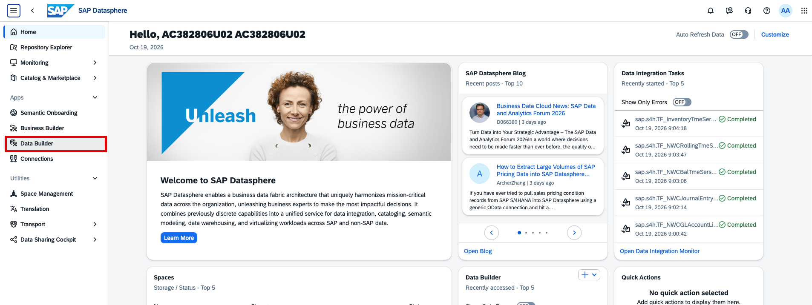
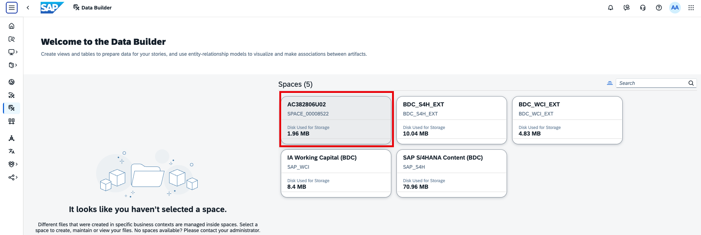
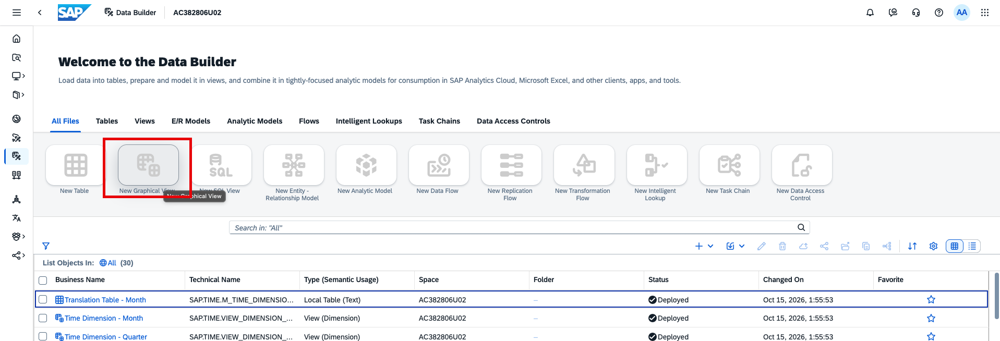
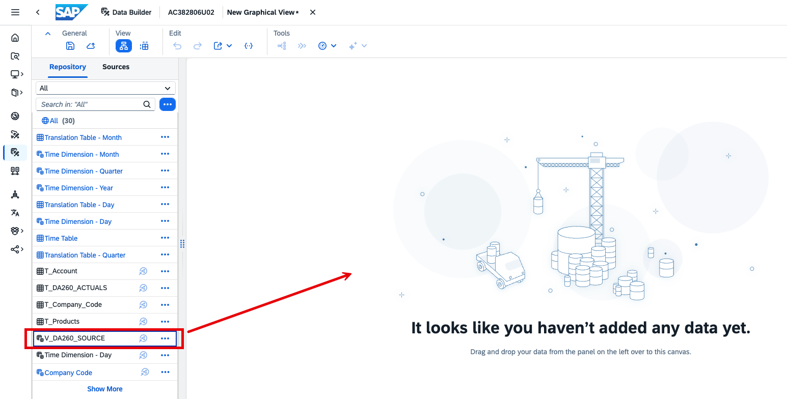
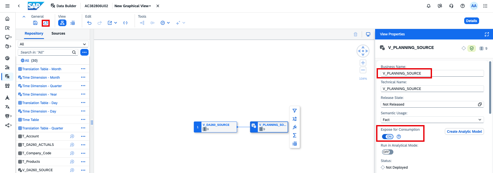
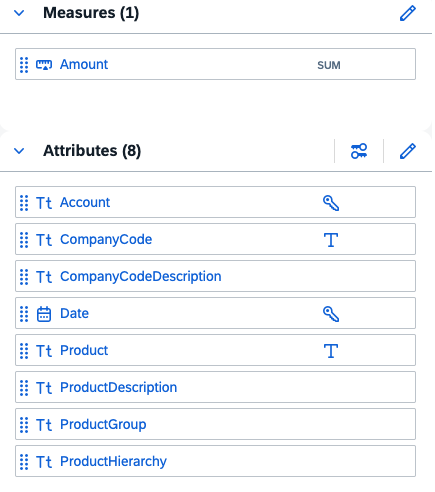

# Create base view for planning model in SAP Datasphere
In this exercise, you will build a view from which we will later create a planning model in SAP Analytics Cloud. The view contains P&L actuals for multiple company codes. 

> [!TIP]
> The underlying view has been shared with you from another SAP Datasphere space and can be considered a data product. If you want to learn more about how data products can be created in SAP Business Data Cloud, have a look at the following TechEd2026 hands-on [DA161 — Develop and Create Data Products in Joule Studio](https://github.com/SAP-samples/teched2026-DA161).

1. Go to the *Data Builder* in [SAP Datasphere](https://trial-bdc-datasphere-3.eu10.hcs.cloud.sap/dwaas-core/index.html)

2. Open your space.

3. Your space already contains items that have been shared with you. Create a new graphical view.

4. Drag view `V_DA260_SOURCE` on to the canvas.

5. Call the view 'V_PLANNING_SOURCE' and make it a fact view exposed for consumption. Deploy it. 

6. Review the column structure. This will be the basis for our planning model in SAP Analytics Cloud later on. You will notice that we added information like descriptions and hierarchy levels in the columns for some dimensions. You will use these later in SAP Analytics Cloud. 

