# Create the seamless planning model in SAP Analytics Cloud
In this exercise, we will use the `V_PLANNING_SOURCE` view from SAP Datasphere and use it to build a seamless planning model. 

> [!TIP]  
> We will use the live version feature for seamless planning. Should you need more information, find it in the [SAP Community](https://community.sap.com/t5/technology-blog-posts-by-sap/unlocking-the-next-chapter-of-seamless-planning-in-sap-business-data-cloud/ba-p/14243864).
> More basic information on seamless planning can be found in [this blogpost](https://community.sap.com/t5/technology-blog-posts-by-sap/seamless-planning-integration-between-sap-analytics-cloud-and-sap/ba-p/13877679) and in the [SAP help](https://help.sap.com/docs/SAP_ANALYTICS_CLOUD/00f68c2e08b941f081002fd3691d86a7/6d81dcce234b417e8afb8450abab785e.html). 

1. Go to the modeler in [SAP Analytics Cloud](https://trial-bdc-sac-3.eu10.sapanalytics.cloud/sap/fpa/ui/app.html#/home)
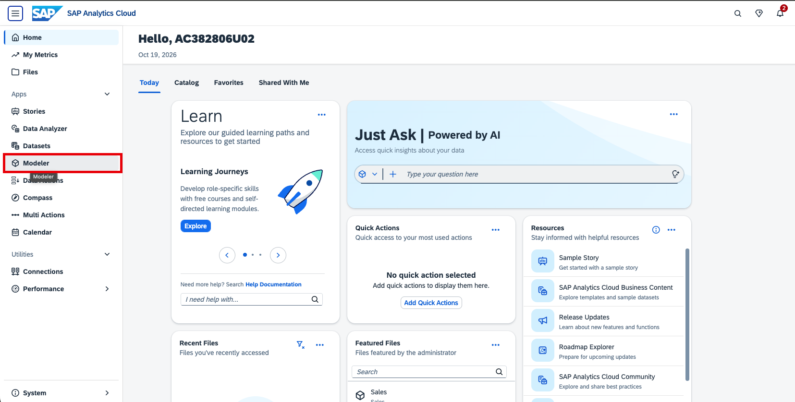

2. Create new model. We start with data.
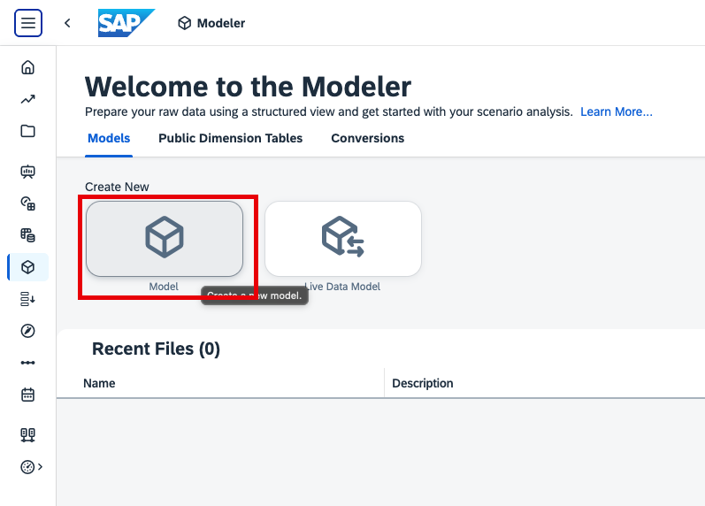
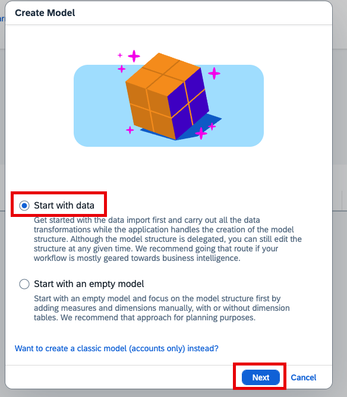

3. Select SAP Datasphere and your user's space as data storage location. Selecting SAP Datasphere as data storage location means that you will use seamless planning. You will see your space name <mark>`AC382806Uxx`</mark>. Use this space. 
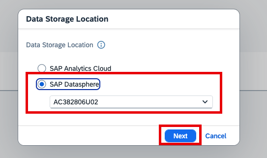

4. Now you select the datasource for your model. We select *SAP Datasphere*. By that, we will directly create a live connection to our source view via a live version.
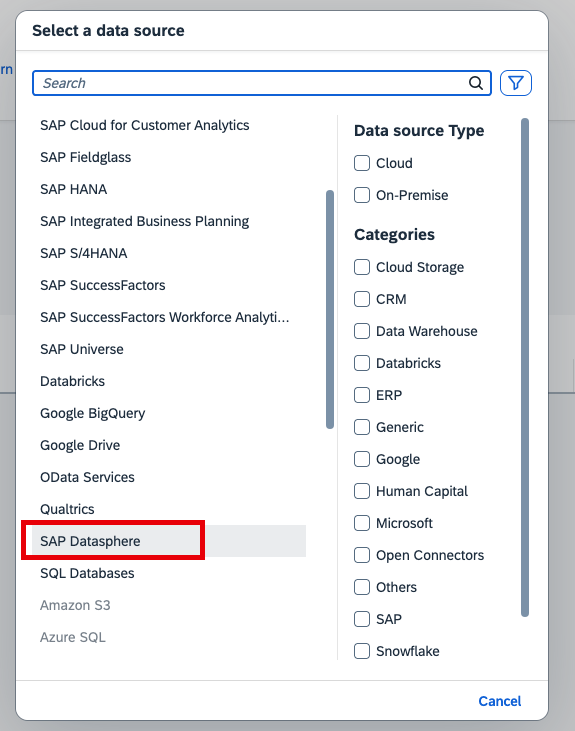

5. Select the view that you created in [exercise 1.1](../ex1_create_planning_model/ex1.1_create_DSP_view.md).
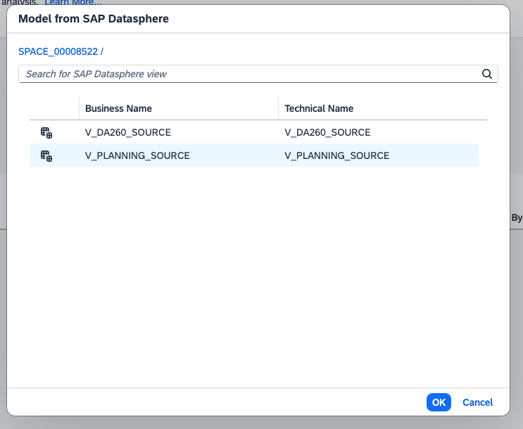

6. You now see the columns that you saw in the SAP Datasphere view. Start grouping columns by adding the 'CompanyCodeDescription' column as the description of the 'CompanyCode' column. 
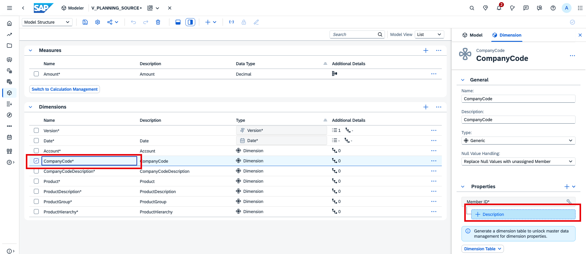
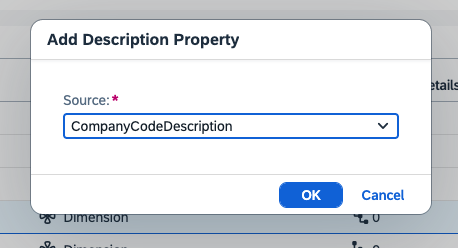

7. Do the same for the product dimension.
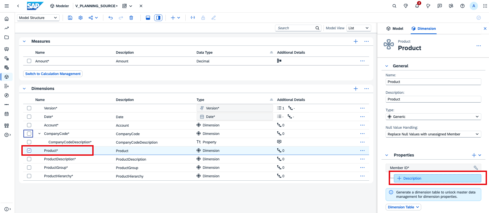
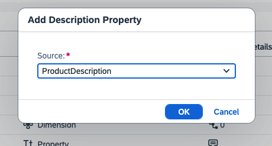

8. Convert 'ProductGroup' and 'ProductHierarchy' to text properties of the 'Produt' dimension.
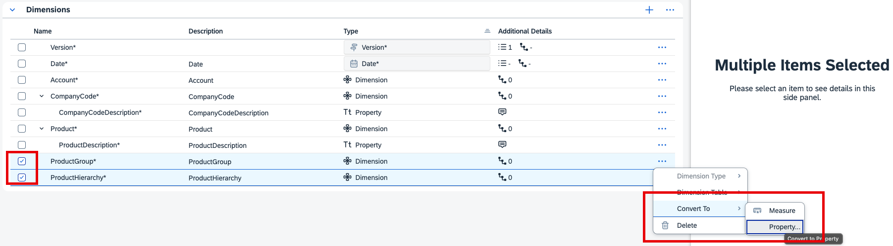
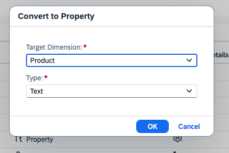

9. Create a level-based hierarchy.
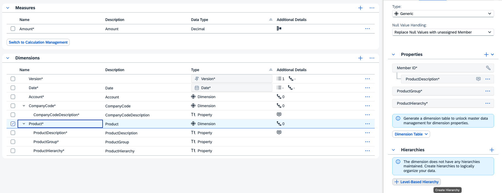

10. Name the hierarchy. Set 'ProductHierarchy' as level 1 and 'ProductGroup' as level 2.
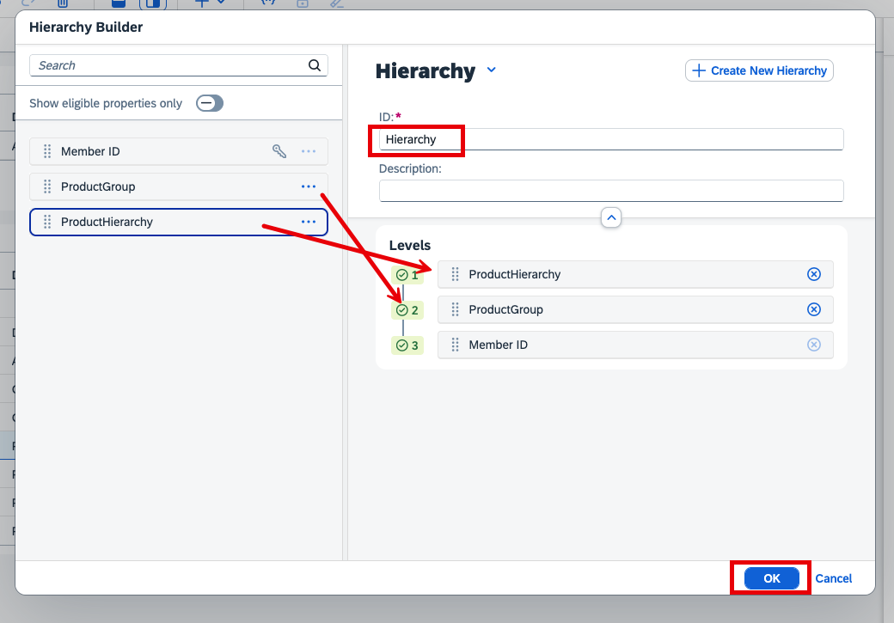

11. Create an account dimension from the 'Account' column.
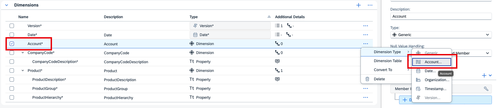
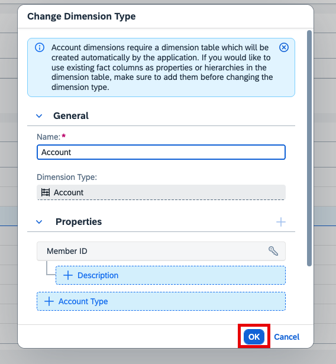

13. Edit the account dimension.
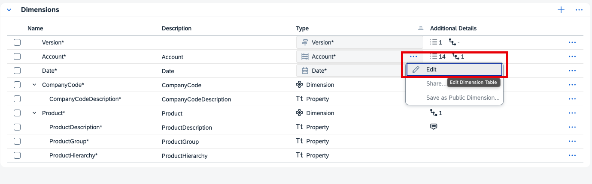

14. Toggle grid view.
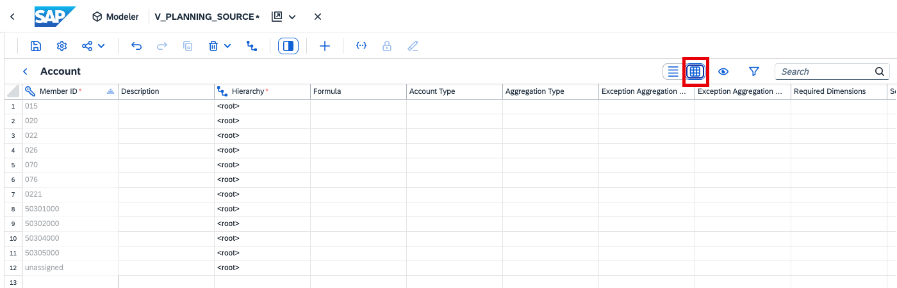

15. Paste master data from this [Excel file]([../files/DA260_Account.xlsx](https://github.com/Sygyzmundovych/teched2026-DA260/raw/refs/heads/main/exercises/files/DA260_Account.xlsx)). Download it, open it and copy paste using keyboard shortcuts (CTRL+C / CTRL+V). 
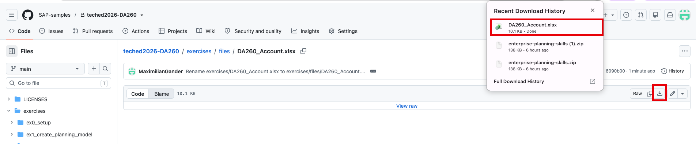

For lines marked as base members in column D, only paste descriptions and hierarchy nodes. These account already exist in the dimension table in SAP Analytics Cloud. For all other accounts, copy, ID, description and hierarchy node.

The final result should look as follows:

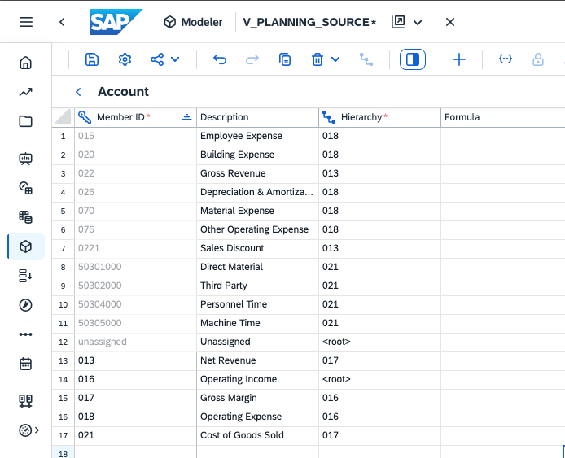

16. Save the model

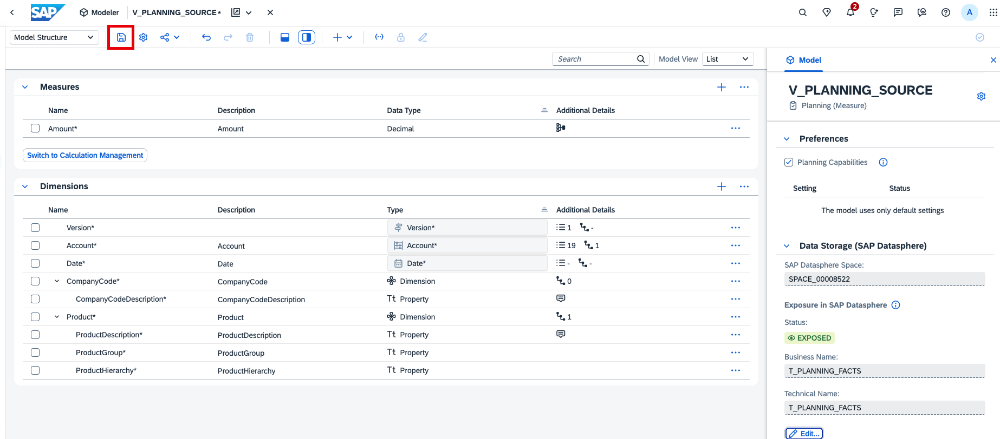
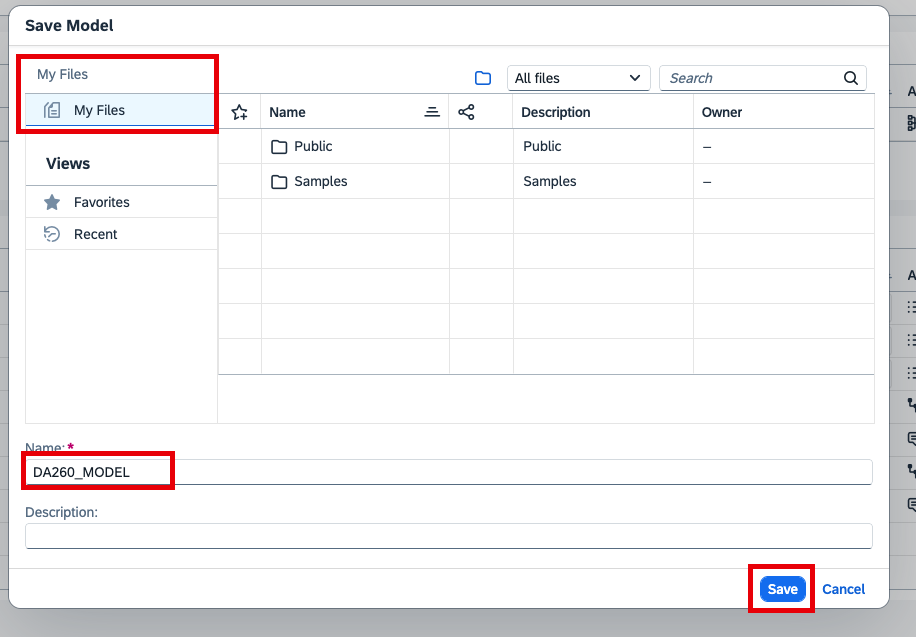

18. Expose the model's fact data in the data builder of SAP Datasphere. Call the table 'T_PLANNING_FACTS'.
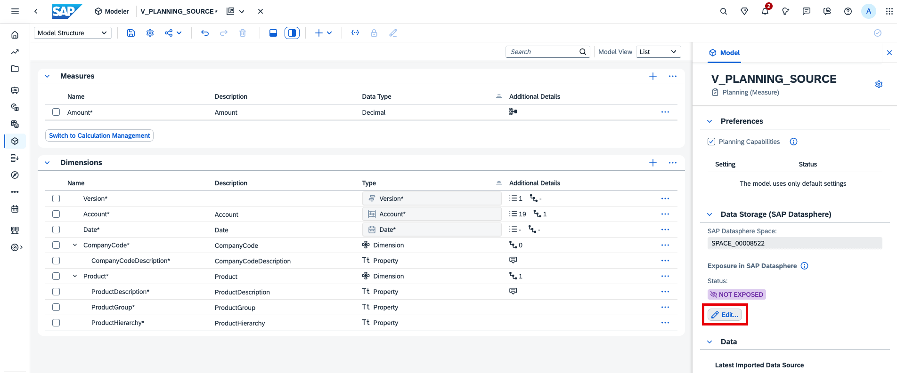
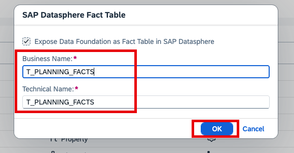

17. Add a budget version by editing the 'Version' dimension table.
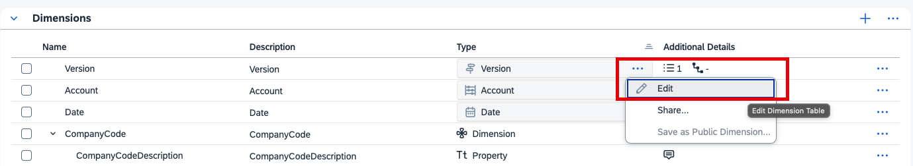
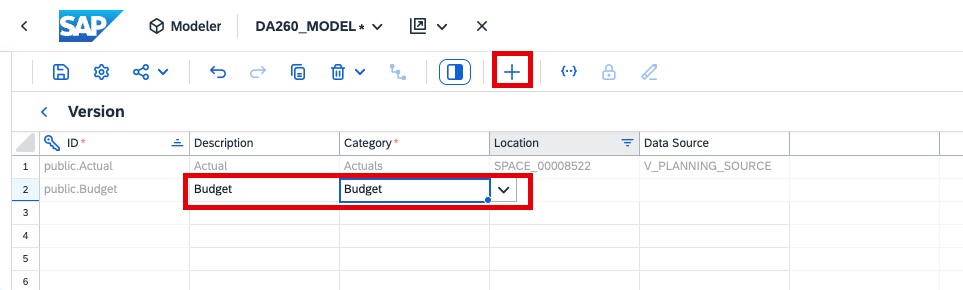

18. Extend the model's date range. Click on the token of the 'Date' dimension and set the range from 2024 to 2027.
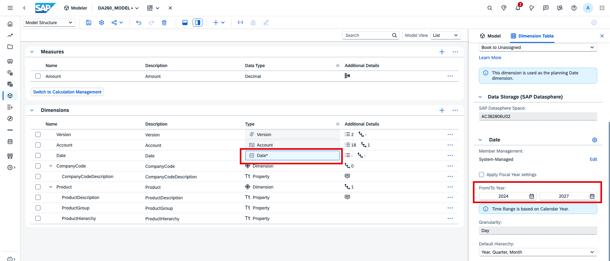

19. Review the model structure and the data preview. Note the live connection of the 'Actual' version to the source view that we based our model on.
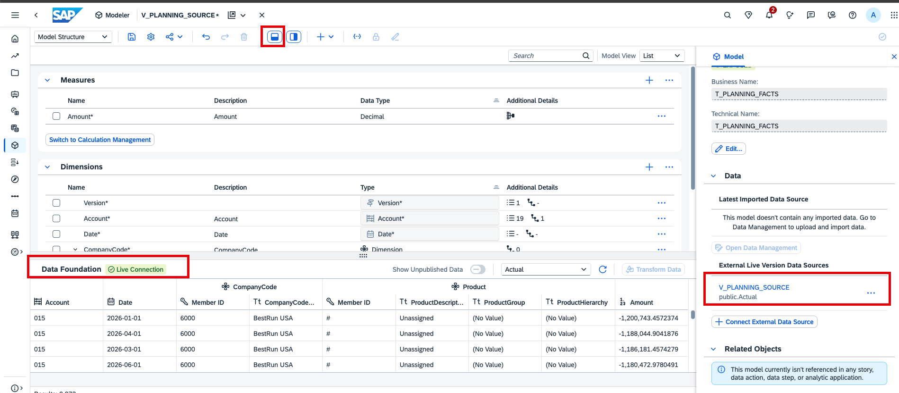

20. Save the model. Call it 'DA260_MODEL'.

> [!NOTE]  
> Number of records (as displayed in the data preview), overall sums and values can differ between the screenshots in this exercise and what you see in your models, stories, and previews. This can be due to recently added filters, standard data updates in the source etc. The transactional data does not matter too much in this workshop. So don't worry.

Continue to [exercise 1.3](ex1.3_load_budget_data.md).
