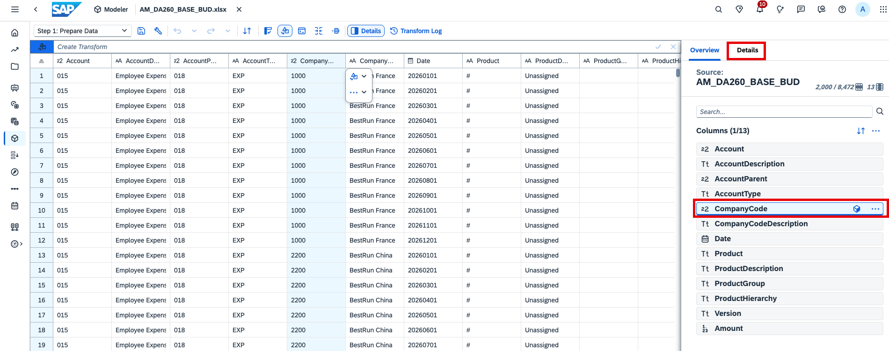
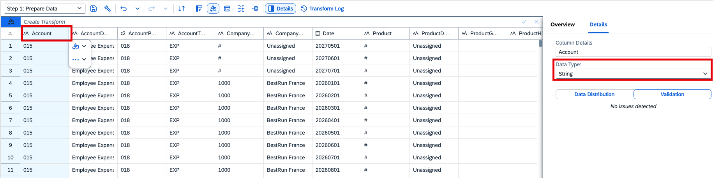
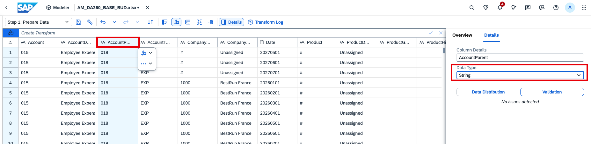
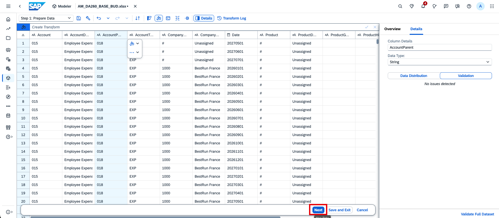
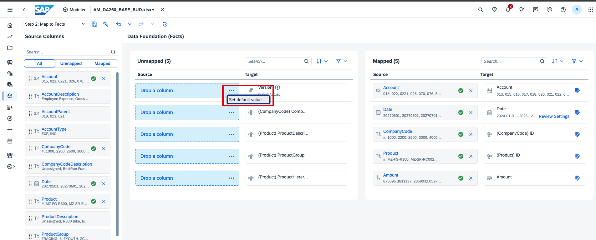
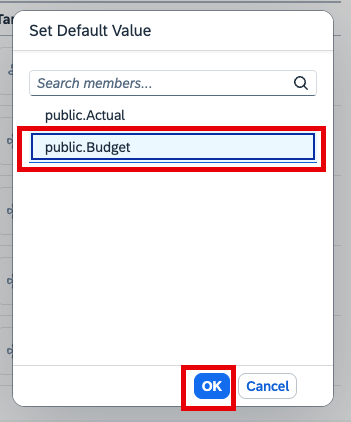
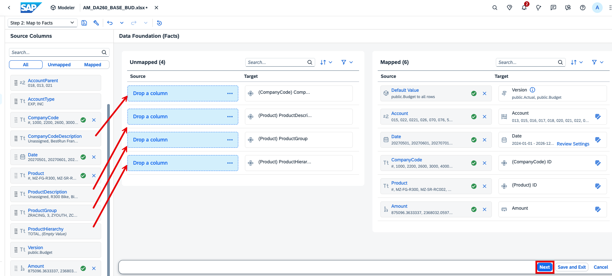
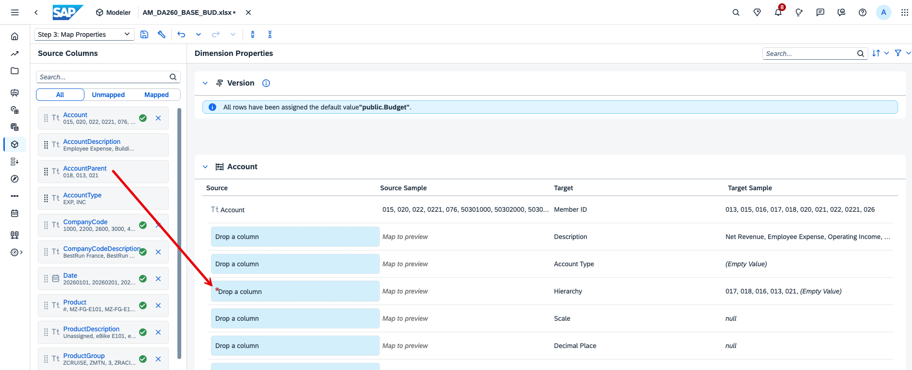
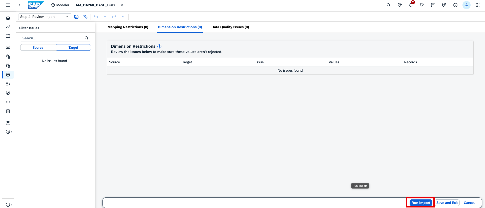
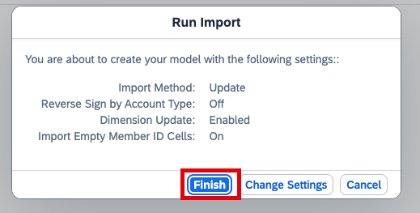

# Load budget data
In this exercise, you will add budget data to your model via a data import job. 

1. Download this [Excel file](https://github.com/SAP-samples/teched2026-DA260/raw/refs/heads/main/exercises/files/AM_DA260_BASE_BUD.xlsx) to your computer. 

2. Navigate to Data Management.

3. Import data

4. Select the Excel file you just downloaded.

   

6. Set up the import.
   

7. Open the Company Code column etails and set the column as String. If it is String already, move on. 

8. Set 'Account' and 'AccountParent' as String. You can do so by clicking on the column header names in the grids.

9. Click 'Next'.
 

10. Set 'Public.Budget' as default version.
 
 

11. Map 'CompanyCodeDescription', 'ProductDescription', 'ProductGroup', 'ProductHierarchy' as per the image below. Then click next.
 

12. Map 'AccountParent'
 

13. Click 'Next', 'Run Import' and 'Finish'
 
 

Move on to [exercise 2](../ex2_create_planning_story/ex2_create_planning_story.md) to create a story and plan. 
