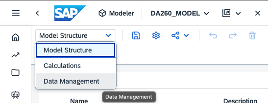
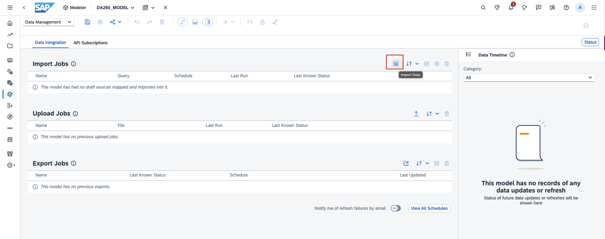
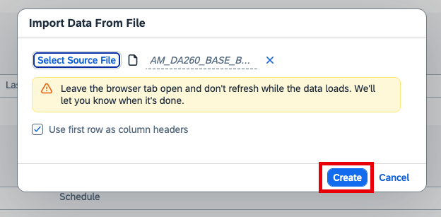
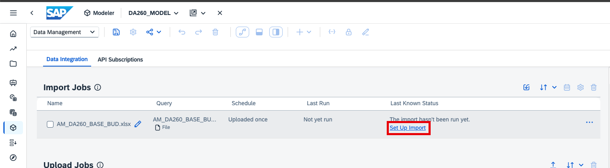
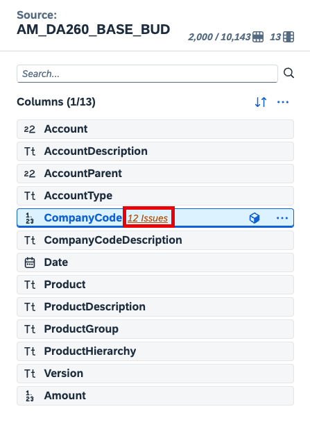
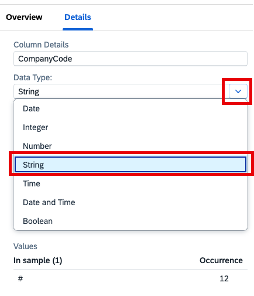

# Load budget data
In this exercise, you will add budget data to your model via a data import job. 

1. Download this [Excel file](../files/AM_DA260_BASE_BUD.xlsx) to your computer. 
2. Navigate to Data Management.

3. Import data

4. Select the Excel file you just downloaded.
   

5. Set up the import.
   

6. Review the issues on the Company Code column and set the column as String.

