# Create planning story
In this exercise, you will build a story on the of the model that you created in [exercise 1](../ex1_create_planning_model). 

## Basic layout and planning table

1. Create a story. You can start directly from your model.
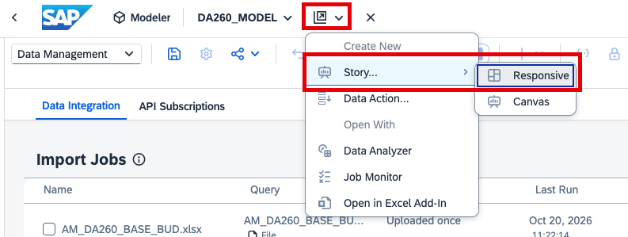

Close the information pop-up in case it appears.

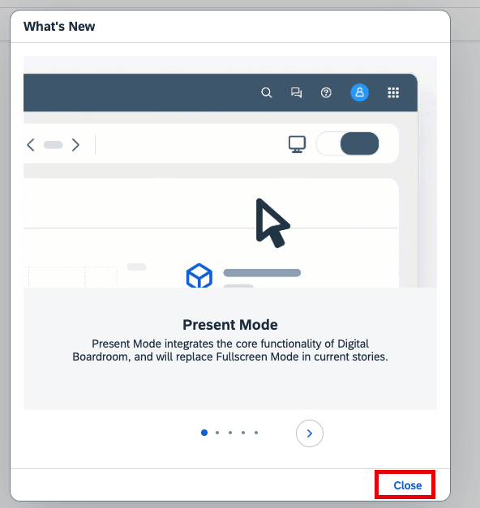

2. You can use a composite to re-use a predefined page header. Import it from the `Public/TechEd2025_DA267` folder.
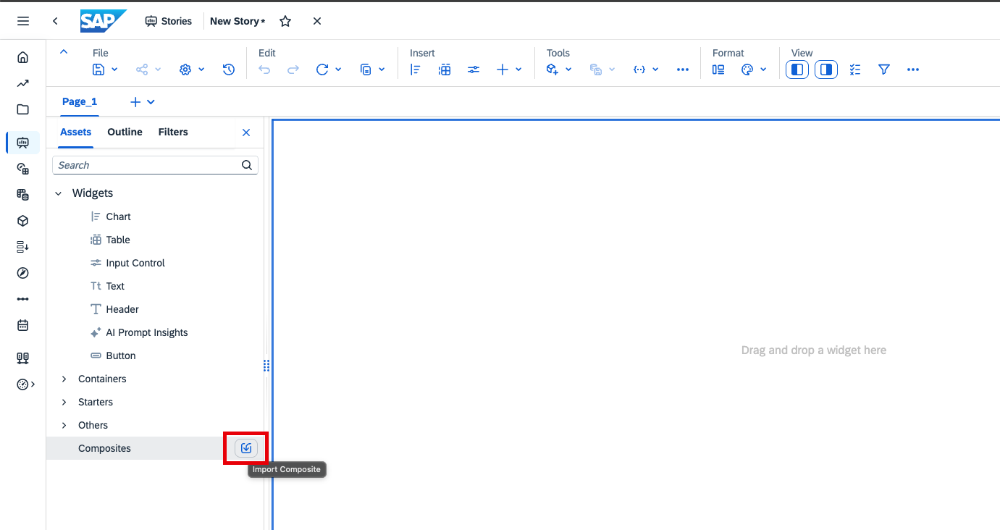
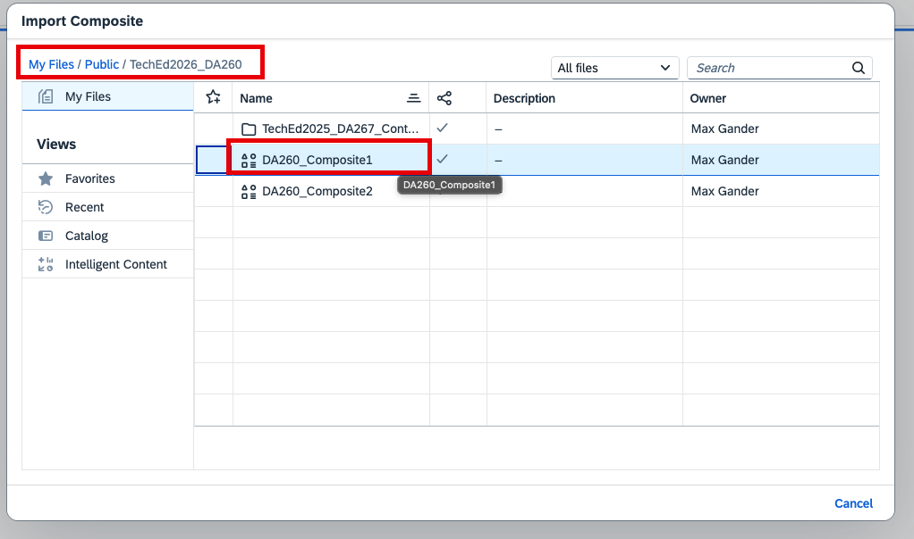

3. Drag the composite to the top left corner of the canvas.
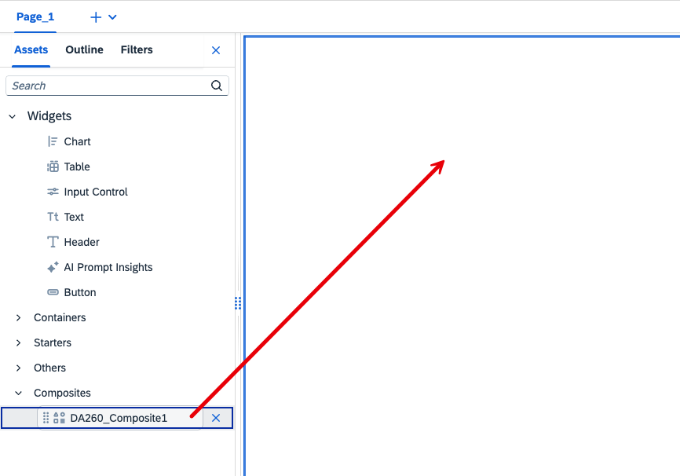

4. Add a table. 
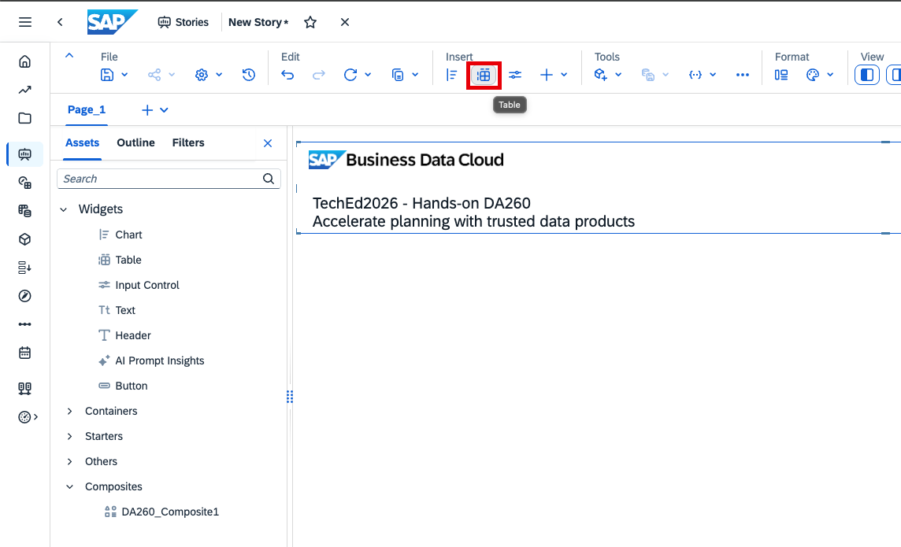

5. Configure the planning table as follows. Basic story building skills are assumed. Hence, no click-by-click guide is provided. Instead, refer to the gif.

Rows: 
- `Company Code`
- `Account`

Columns: 
- `Measures`
- `Version` --> Filter `Amount`
- `Date`--> Set visibility levels
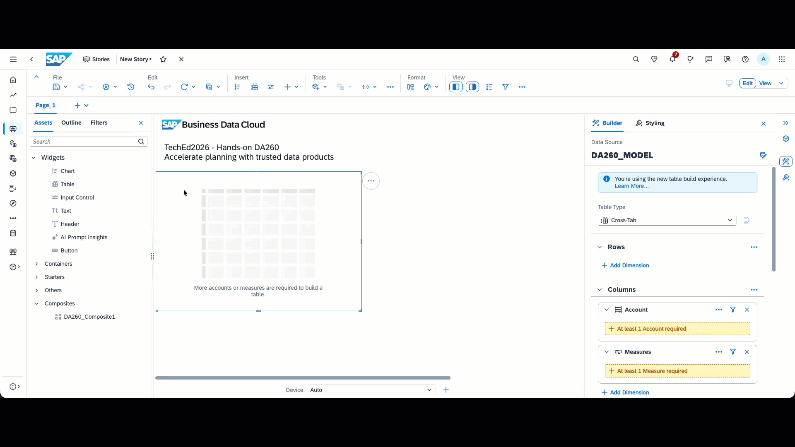

6. Save your story under 'My Files'. Call it 'DA260_Story'

## AI-assisted prompt insight widget

> [!NOTE]
> The AI-assisted prompt insight widget enables designers to embed predefined LLM prompts into SAP Analytics Cloud stories and use existing tables and charts as analytical context. Power users and implementation teams can provide targeted AI experiences that are prepared and governed. Learn more in this [blogpost](https://community.sap.com/t5/technology-blog-posts-by-sap/enrich-sap-analytics-cloud-story-dashboards-using-the-ai-assisted-prompt/ba-p/14466018)

1. Add AI Prompt Insights widget
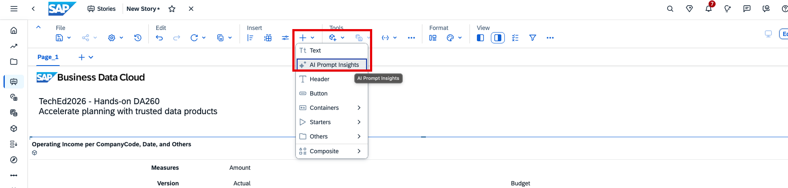

2. In the builder panel of the widget, bind it to the table
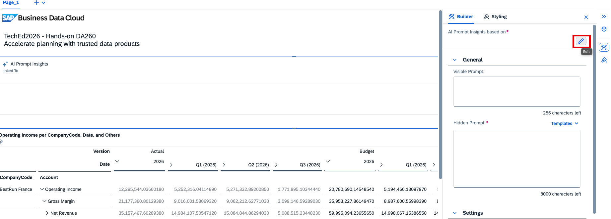
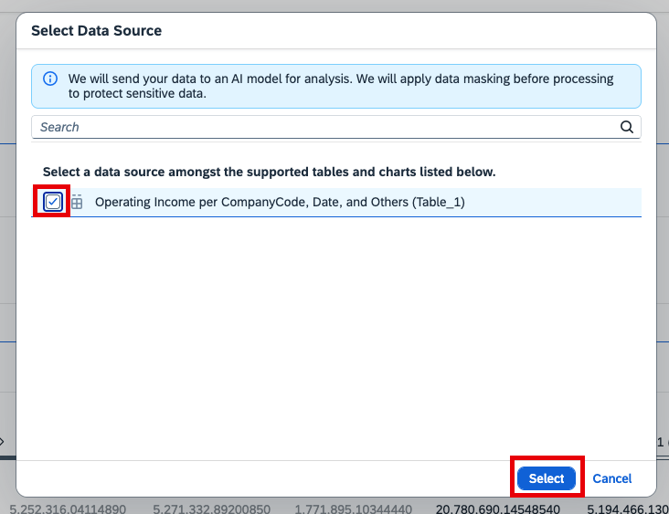

3. The widget offers a visible and an invisible prompt. The visible prompt shall give story consumers enough insight into what the widget analyzes. The invisible prompt can provide more information and technical hints.  

For the visible prompt, add:
> Analyze deviations in my YTD performance from January 2026 until July 2026 in terms of deviations between Actual and Budget.

For the invisible prompt, add:
> Analyze deviations in my YTD performance from January 2026 until July 2026 in terms of deviations between Actual and Budget. Are there Company Codes that are significantly below budget? Pay specific attention at the revenue budget adherence. Do not look at total year at all. Just look at January-July

4. Choose concise mode. You can experiment with this setting if you want to (change is possible at run time). 
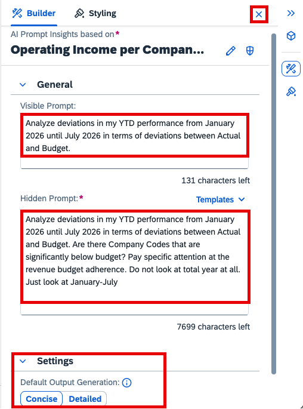

5. Generate the insights
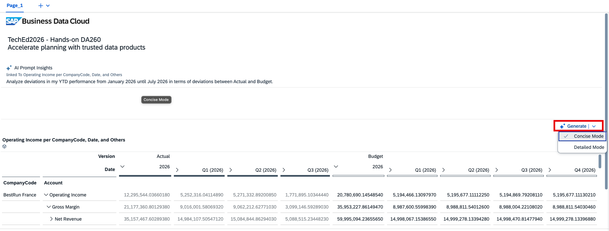
