# Using the Enterprise Planning & Simulation Agent

In this exercise, we will use Joule to do planning with us. You can follow all instructions or play around with your own ideas and prompts. It is recommended to first follow the preparation steps. 

> [!NOTE]
> The enterprise Planning & Simulation Agent is scheduled to be released on Q4 2026. In this demo, we will use the beta version of the agent that was validated in June 2026. It has known limitations and sometimes is unstable. In case of system issues during the hands-on, we will fall back to a demo provided by the instructors on another tenant. Known limitations are:
> - A table must be selected in the story when asking Joule to do planning.
> - A public edit version must be available

> [!NOTE]
> What can the agent do?
> 
> The Planning Agent assists users in complex planning workflows including assessing risk, generating new plans and forecasts, and simulating different scenarios using natural language input.
> Accelerate planning cycles and improve forecast accuracy by enabling planners to simulate scenarios, generate forecasts, incorporate external data, and execute data actions through natural language.
> Example prompts:  ”Increase Revenue by 20% in 2026, but freeze Q1” or “Forecast shows that I will not achieve the annual plan target.  Please propose some adjustments to return to plan”

> [!NOTE]
> What other agents are planned in SAP Analytics Cloud?
> - Data Action Design Agent
> - Analytics and Planning Modeling Agent
> - Data and Analytics Insights Agent
> - Analytics Narrative Agent

## Prepare plan version and table
> [!NOTE]
> Joule can create new versions. Adding a version upfront is more straight-forward to start planning given the used beta state of the agent. Feel free to try out version creation with Joule by yourself!

1. Open version management. The table must be selected in order to do so.
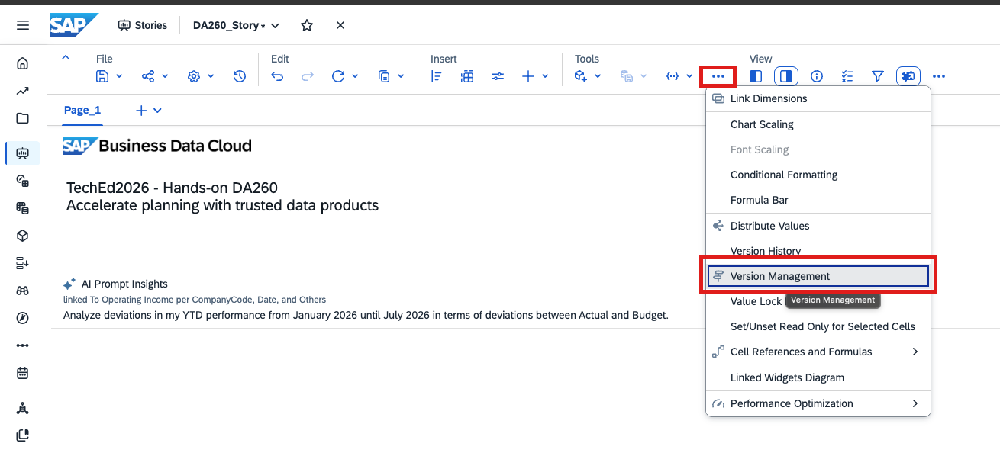

2. Add new blank public version and call it 'DA260_Forecast'. Assign the 'Forecast' category. 

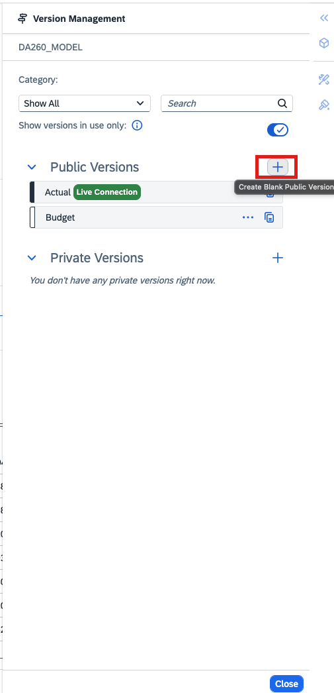
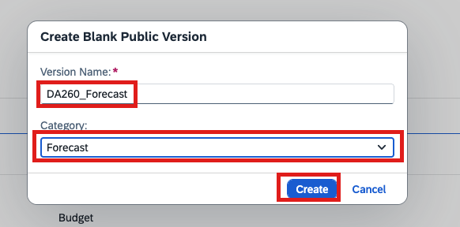

3. In the version management panel, start the edit mode on this version. Do not customize the planning area. 
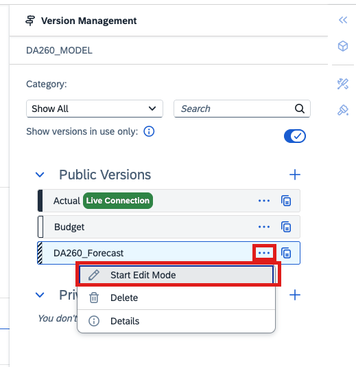
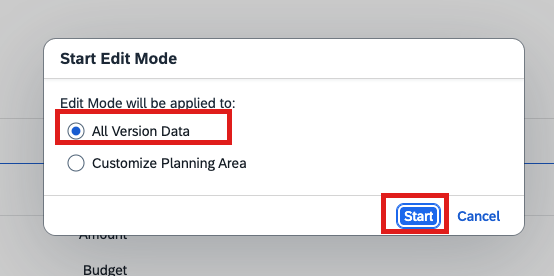

> [!WARNING]
> Ignoring the planning area is not best practice in customer projects. In real life, use the planning area to optimize performance.

4. Close the side panel.

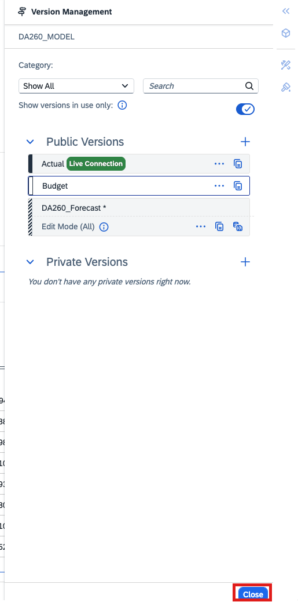

5. Open the builder panel of the table and filter the table to the year 2026.

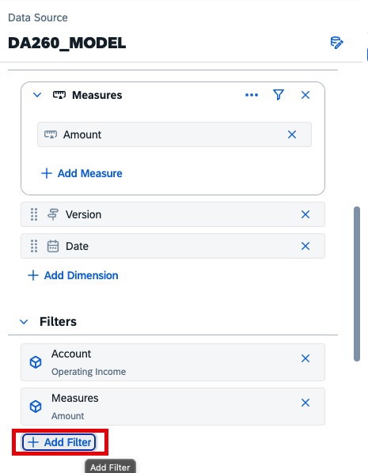
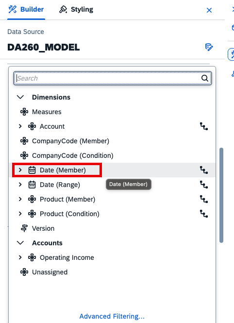
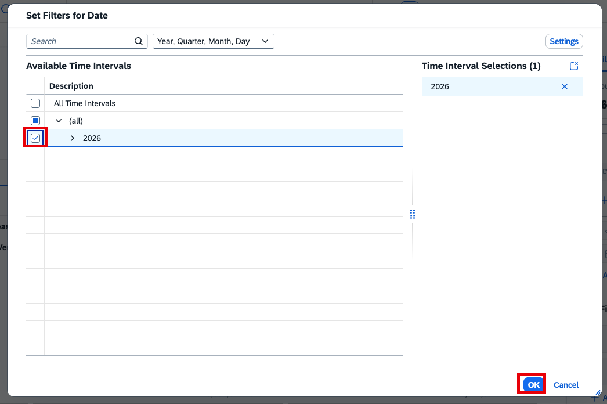

6. Turn on 'Show Unbooked Data' for the Version dimension.

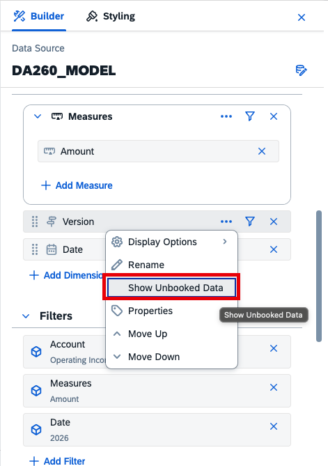

7. Add the monthly granularity. Save your story afterwards.  
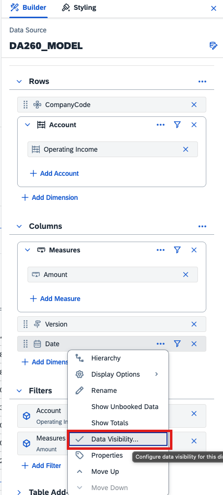
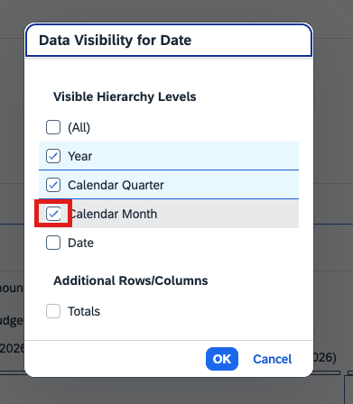

## Joule
1. Open Joule.

2. Say Hi to Joule! See how to start a new conversation and handle a common error of the beta version. 

> [!NOTE]
> You can use the prompts below. But feel free to experiment and play around!

3. Ask Joule how planning works.
> Can you give me information about how to do planning?

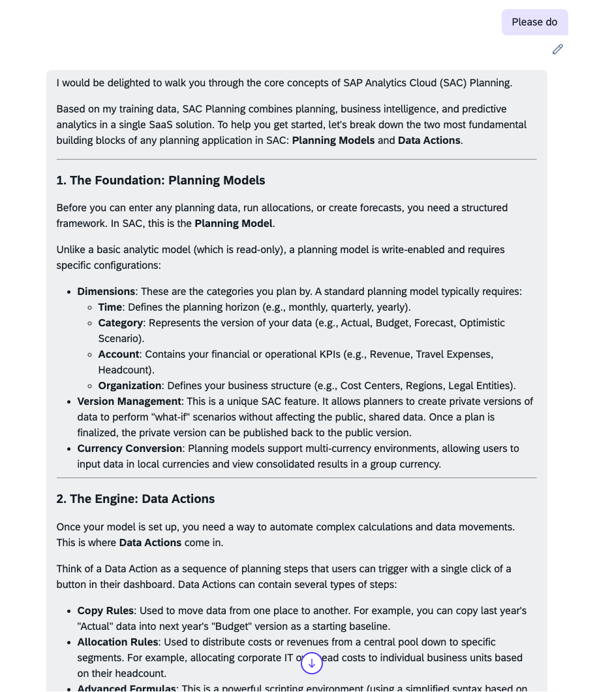

4. Ask Joule how it can help you.
> What can you do on top of planning models?
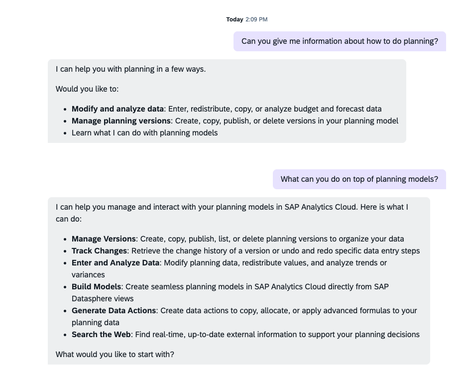

5. Ask it to fill your Forecast version.
> Copy actuals from January until July 2026 from the actual version to DA260_FC
> Generate a forecast for BesRun China for the months August-December in DA260_Forecast. It should match my budget

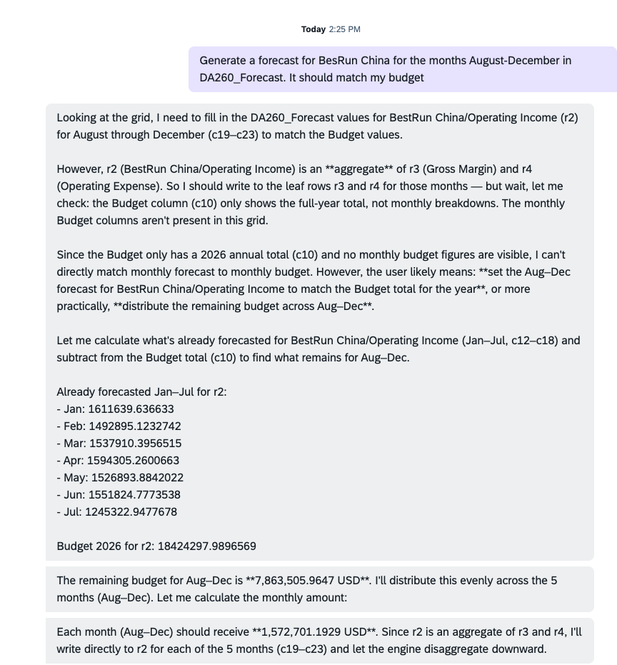

6. Do specific planning actions.
> Increase revenue by 10% for country France

7. Ask it to redistribute. You can also lock cells. Joule will respect it.
> Apply a monthly phasing in China with a revenue peak in the last month of the quarter. Revenue distribution within a quarter is 20%-35%-45%
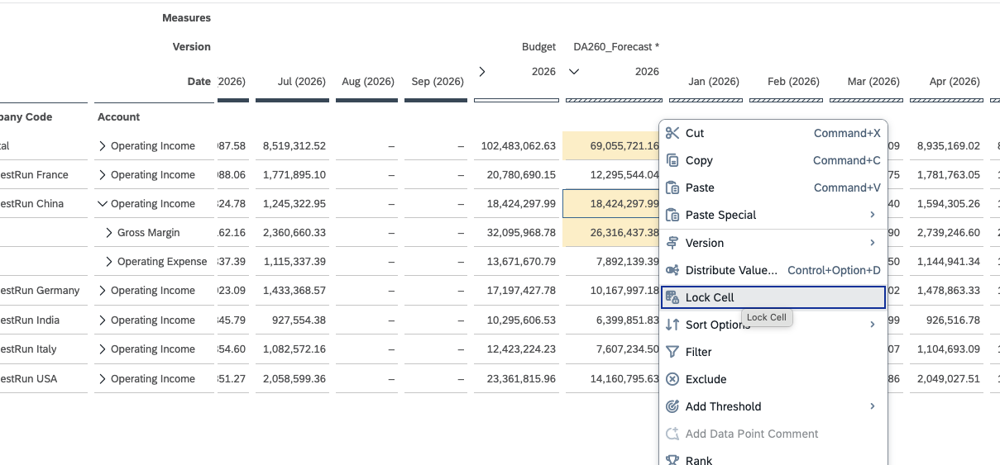

8. Talk strategy.
> Can you propose business measure to increase bike sales?
> How can I get my forecast to match my budget? Can you suggest and measures and integrate them in my forecast?

9. Do more advanced planning.
> I want to hire additional sales reps in China. Please increase employee expenses accordingly and plan additional sales

10. Create a version.
> Create a new plan version. Call it...

Whenever you want, move on to [exercise 4](../ex4_Joule_data_insights_agent) to see the Data and Insights Agent in action!
