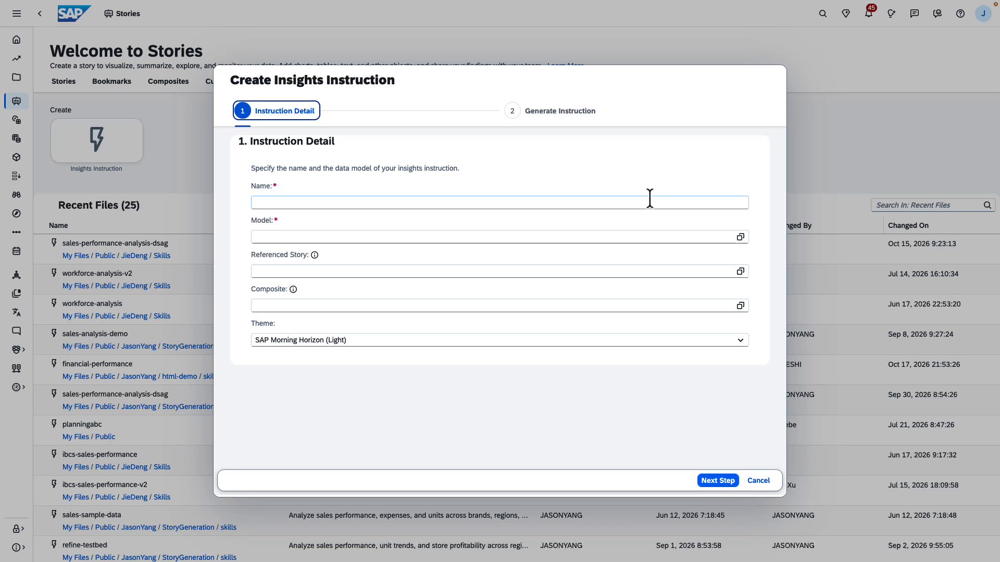
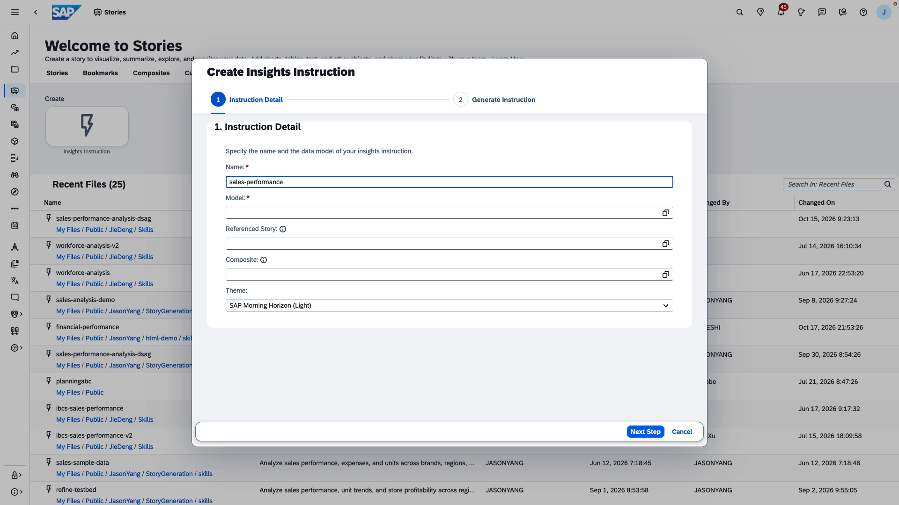
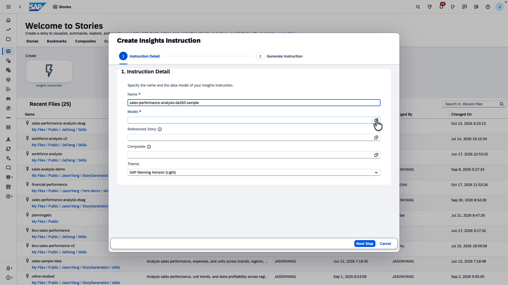
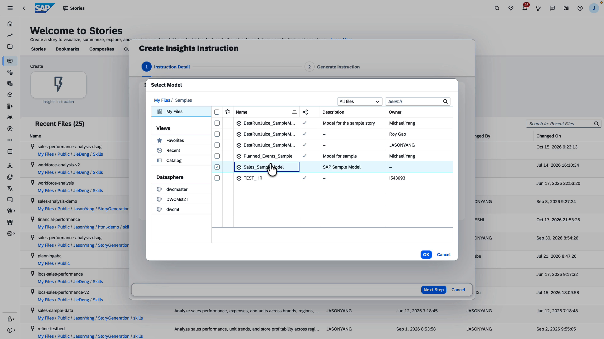
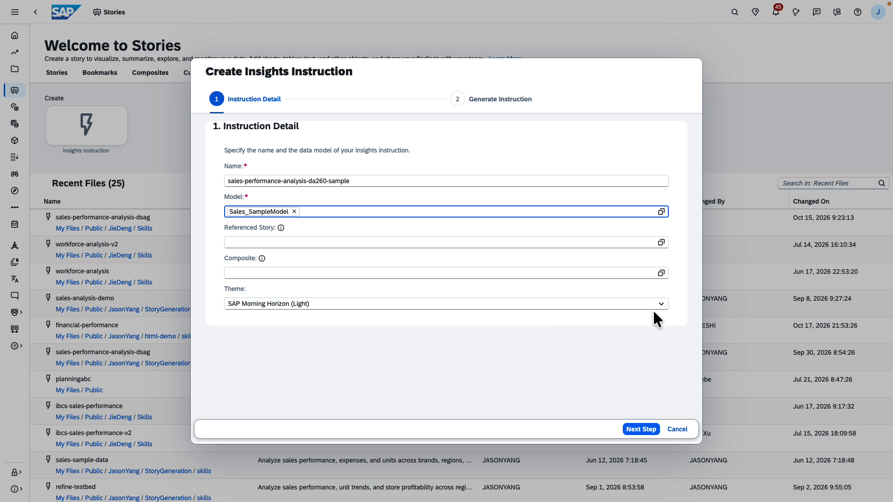
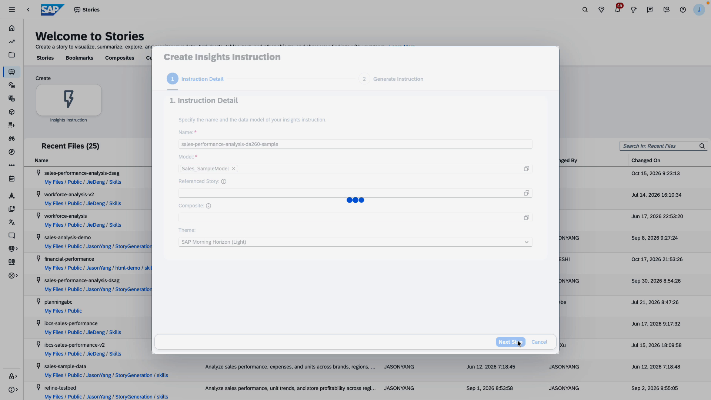
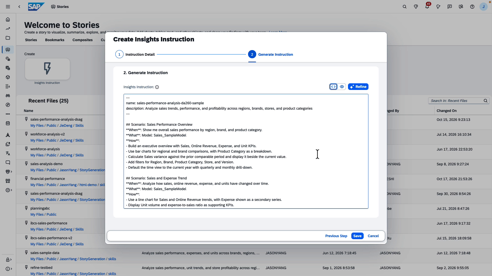
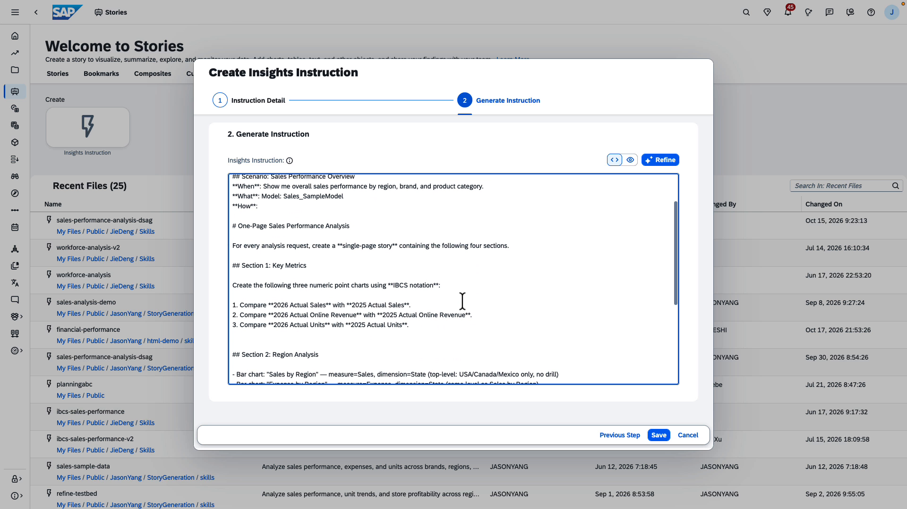
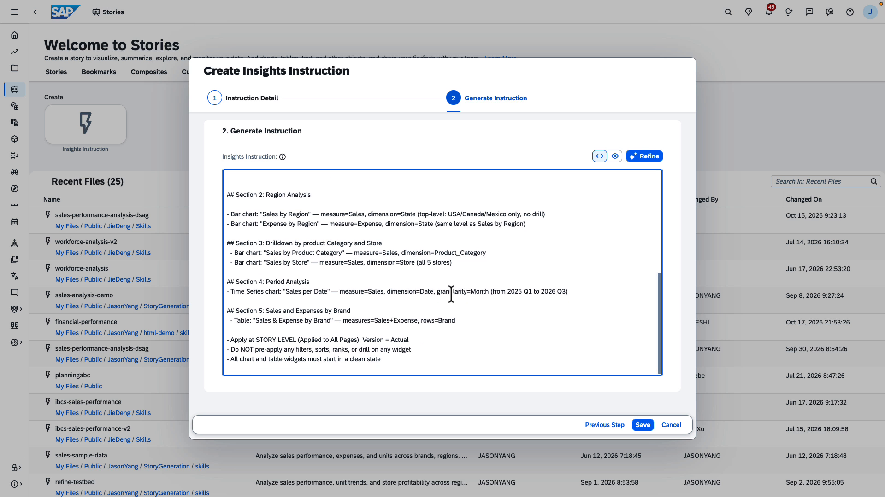

# TechEd Hands-On Session: Creating an Insights Instruction in SAP Analytics Cloud

**Session:** DA260 — Data and Analytics Insights Agent with SAP Analytics Cloud  
**Duration:** approx. 10 minutes  
**Difficulty:** Beginner  

---

## Overview

In this hands-on exercise you will create an **Insights Instruction** in SAP Analytics Cloud. An Insights Instruction is a reusable SAC artefact that tells the story-generation AI *when* to act, *what* data model to use, and *how* to build the resulting story. Once saved in SAC, it can be referenced to generate tailored, data-driven SAC stories.

**What you will do:**

1. Open the Create Insights Instruction editor.
2. Provide a name and link a data model.
3. Let the AI generate the instruction content and modify it.
4. Review and save the instruction to a shared folder.

**Prerequisites:**

- You are logged into SAP Analytics Cloud and can access **Stories**.
- The sample model **Sales_SampleModel** is available under *My Files / Samples*.
- You have the permission of insights instructions.

---

## Step 1 — Open the Create Insights Instruction Dialog

Navigate to **Stories** from the SAP Analytics Cloud left navigation bar (the chart-bar icon). On the *Welcome to Stories* page, locate the **Create** panel on the left and click the **Insights Instruction** tile (the tile with the lightning-bolt icon).

The **Create Insights Instruction** wizard opens as a modal dialog. It has two steps shown in the progress bar at the top:

- **Step 1 — Instruction Detail** (currently active, highlighted in blue)
- **Step 2 — Generate Instruction** (inactive for now)

The form shows five fields: *Name* (required), *Model* (required), *Referenced Story*, *Composite*, and *Theme*.



> **Tip:** The *Theme* dropdown already defaults to **SAP Morning Horizon (Light)**, which is the recommended theme for new stories. You can leave it as-is for this exercise.

---

## Step 2 — Enter the Instruction Name

Click inside the **Name** field and type the following name exactly as shown:

```
sales-performance-analysis-da260-xx
```

xx is your seatnumber. The name is used as the file name when the instruction is saved, so use lowercase letters and hyphens only (no spaces or special characters).



> **Note:** The field is highlighted with a blue border while it has focus. The asterisk (*) next to the label indicates the field is required — you cannot proceed without a value here.

---

## Step 3 — Open the Model Picker

Next, link a data model. Click the **browse icon** (small file-picker icon) on the right side of the **Model** field to open the model selection dialog.



> **Tip:** The Model defines the schema (dimensions, measures, hierarchies) that the AI uses when generating chart recommendations. Choosing the right model is critical for relevant output.

---

## Step 4 — Select the Sales Sample Model

The **Select Model** dialog opens. It shows a file-browser panel on the left (My Files, Views, Datasphere connections) and a file list on the right.

Navigate to **My Files → Samples** using the left panel. Find **Sales_SampleModel** in the list and click its row to select it (the row highlights in blue and a checkbox appears).

Click **OK** to confirm your selection and close the dialog.



> **Note:** The description column next to *Sales_SampleModel* reads "SAP Sample Model", confirming this is the correct pre-loaded model for this exercise.

---

## Step 5 — Confirm the Filled-In Form

Back in the editor of insights instruction, the **Model** field now shows a tag reading **Sales_SampleModel ×**. The × lets you remove the selection if needed.

Verify that both required fields are correctly filled in:

| Field | Value |
|---|---|
| **Name** | `sales-performance-analysis-da260-xx` |
| **Model** | `Sales_SampleModel` |

The remaining optional fields (*Referenced Story*, *Composite*, *Theme*) can be left at their defaults.



> **Tip:** The *Referenced Story* field lets you link an existing story so the used models in reference story can be directly added into this insights instruction. Leave it empty for this exercise.

---

## Step 6 — Click "Next Step" to Trigger AI Generation

Click the **Next Step** button in the lower-right corner of the dialog. The wizard begins communicating with the AI model. The form fields are temporarily disabled and a three-dot loading animation appears in the center of the dialog while the system analyses the data model and generates the instruction content.



> **Note:** This step typically takes a couple of seconds depending on model complexity. Do not close the dialog or navigate away while the spinner is active.

---

## Step 7 — Review the Generated Instruction (Top Section)

Step 2 — **Generate Instruction** — is now active (highlighted blue in the progress bar). The large text area labelled **Insights Instruction** is populated with auto-generated content.

The top of the instruction contains a **header block** with the name and description, followed by **Scenario** blocks. Each Scenario defines:

- `**When**` — the user intent or trigger phrase
- `**What**` — the data model referenced
- `**How**` — specific chart-building instructions

The AI now suggests a couple of scenarios as the screenshot shown below.



> **Tip:** You can freely edit the text before saving. If the content does not match your requirements, use the **Refine** button (top-right of the text area) to provide additional guidance and re-generate.

---

## Step 8 — Edit the Instruction Content

Leave the **When** and **What** area as it is like from step 7. Please use the below instructions for the **How** area. You can also reference the sample insights instruction **sales-performance-analysis-da260-sample**

# One-Page Sales Performance Analysis

For every analysis request, create a **single-page story** containing the following four sections.

## Section 1: Key Metrics

Create the following three numeric point charts using **IBCS notation**:

1. Compare **2026 Actual Sales** with **2025 Actual Sales**.
2. Compare **2026 Actual Online Revenue** with **2025 Actual Online Revenue**.
3. Compare **2026 Actual Units** with **2025 Actual Units**.


## Section 2: Region Analysis

- Bar chart: "Sales by Region" — measure=Sales, dimension=State (top-level: USA/Canada/Mexico only, no drill)
- Bar chart: "Expense by Region" — measure=Expense, dimension=State (same level as Sales by Region)

## Section 3: Drilldown by product Category and Store
  - Bar chart: "Sales by Product Category" — measure=Sales, dimension=Product_Category
  - Bar chart: "Sales by Store" — measure=Sales, dimension=Store (all 5 stores)

## Section 4: Period Analysis
- Time Series chart: "Sales per Date" — measure=Sales, dimension=Date, granularity=Month (from 2025 Q1 to 2026 Q3)

## Section 5: Sales and Expenses by Brand
  - Table: "Sales & Expense by Brand" — measures=Sales+Expense, rows=Brand

- Apply at STORY LEVEL (Applied to All Pages): Version = Actual
- Do NOT pre-apply any filters, sorts, ranks, or drill on any widget
- All chart and table widgets must start in a clean state




---

## Step 9 — Review Final Sections and Click Save your insights instruction under My Files Folder

Scroll to the end of the instruction to confirm all sections are complete. At the bottom of the dialog you will see three action buttons:


- **Previous Step** — returns to Step 1 if you need to change the name or model
- **Save** — opens the save dialog to store the instruction as a file
- **Cancel** — discards all changes and closes the wizard

Once you are satisfied with the insights instruction, click **Save**.



> **Tip:** The toolbar above the text area offers two additional controls: the **code icon** (`</>`) to inspect the raw structure, and the **eye icon** to preview a formatted view.


> **Success:** After clicking Save, the dialog closes and your Insights Instruction is stored in My Files folder. It is now available for use in any SAP Analytics Cloud story that references this model. 

---

## Summary

You have successfully created an Insights Instruction in SAP Analytics Cloud. Here is a recap:

| Step | Action |
|---|---|
| 1 | Opened the **Create Insights Instruction** editor from the Stories module page |
| 2 | Entered the instruction name: `sales-performance-analysis-da260-xx` |
| 3–5 | Linked the **Sales_SampleModel** data model |
| 6 | Clicked **Next Step** to trigger AI content generation |
| 7–9 | Reviewed and modified the insights instruction. Saved the instruction to **My Files**|

### What's Next?

In the next exercise you will use this Insights Instruction to automatically generate an AI-driven, data-rich story page for sales performance analysis.

---

*SAP Analytics Cloud — TechEd DA260 Hands-On Session*
