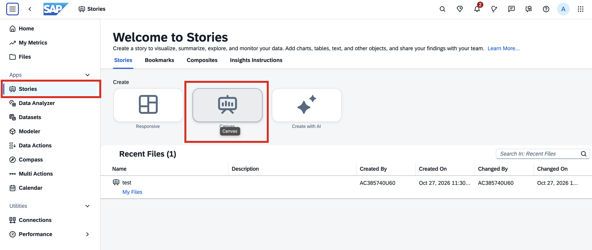
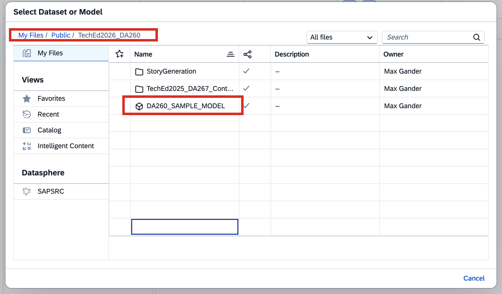

# Available Shortcuts

If you want, you can skip exercise 1 and use the `DA260_SAMPLE_MODEL` instead of building your own model. It does not have live actuals but ultimately, this does not matter for the exercise.
Also, you can directly jump to exercise 4 to use the Data and Analytics Insights Agent as this exercise works on another sample model.

## Shortcut 1 - Create planning story directly based on sample model

Use the model `DA260_SAMPLE_MODEL` from the folder `TechEd2026_DA260` to build a story, add the AI widget and use Joule. 

### Step 1 - Create a story. 

### Step 2 - Continue with exercise 2

Import the composite as described in exercise 2. When adding the table, choose the sample model from the `TechEd2026_DA260` folder. Then continue with exercise 2 as described.

## Shortcut 2 - Direct jump to exercise 4
Exercise 4 is based on an SAP Analytics Cloud sample model that is available on this tenant. You can jump to exercise 4 directly to use the insights instructions and the Data and Analytics Insights Agent.
